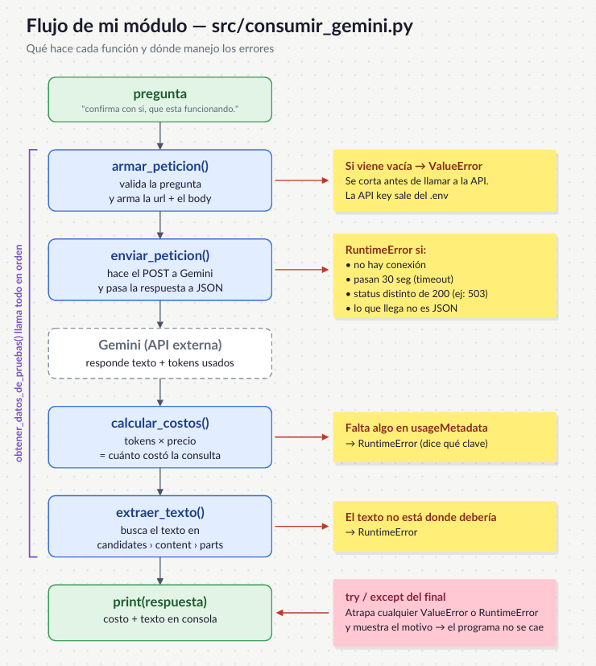

# Decisión de Arquitectura: elección de modelo

Fecha de la comparación: Sábado 24 de octubre 2026
Nombre de la Miniaplicación: "mi miniproyecto"

# Modelo elegido

Elegí el modelo: **gemini-3.6-flash**

Mi miniaplicación sirve para: que la gerencia y las jefaturas de una constructora puedan hacer preguntas normales, como "¿cuántos trabajos hizo Julio Varela?" o "¿cuántos trabajos hay en Principal Baja?", y obtener la respuesta sin tener que filtrar el Excel a mano. Por ahora trabaja con un Excel de registros de mantenimiento de vía.

Los requisitos que necesito cumplir son:
* Que el número sea exacto. Si el reporte dice 22 trabajos, tienen que ser 22.
* Que si hago la misma pregunta dos veces, me dé la misma respuesta.
* Que responda en JSON, para poder leer la respuesta desde Python.
* Que el programa no se caiga si la API falla, y que avise por qué no pudo responder.

# Diagrama de arquitectura

El modelo que elegí es la parte del diagrama que recibe la pregunta junto con los datos del Excel y devuelve la respuesta.

# Comparación de candidatos

Para que la comparación fuera justa, a los tres modelos les di lo mismo: el mismo Excel de 79 registros, el mismo prompt y 4 intentos por pregunta, usando mi script `src/evaluaciones_modelos.py`. Las respuestas correctas las saqué aparte con pandas, para tener con qué comparar.

Las preguntas fueron:

1. ¿Cuántos registros tiene Julio Varela? (correcto: 22)
2. ¿Cuántos trabajos hay en el ramal RPPAL-BAJA? (correcto: 53)
3. ¿Cuántos registros tiene Ismael Calle? (correcto: 11)
4. ¿Cuántos registros tienen a Julio Varela en el ramal RPAMPA? (correcto: 5)
5. ¿Cuántos trabajos hay en Pampa? (esta salió ambigua, lo explico más abajo)

| Criterio | gemini-3.6-flash | gemini-3.5-flash-lite | gemini-3.1-flash-lite |
|---|---|---|---|
| Tarifa de entrada en USD por millón de tokens | $0,75 (sube a $1,50 desde enero 2027) | $0,30 | $0,25 |
| Tarifa de salida en USD por millón de tokens | $3,75 (sube a $7,50 desde enero 2027) | $2,50 | $1,50 |
| Latencias observadas en segundos | 22,05 · 16,40 · 8,70 · 11,31 · 10,95 | entre 2,13 y 3,58 | entre 2,10 y 10,45 |
| Latencia promedio en segundos | 13,88 | 2,61 | 3,71 |
| Costo por petición (medido) | $0,0129 USD | $0,0009 USD | $0,0007 USD |
| Errores de la API | 5 (503 y 429) | 0 | 0 |
| Calidad para nuestra miniaplicación | Acertó 4 de 4 (100 %) | Acertó 5 de 16 (31 %) | Acertó 3 de 16 (19 %) |

Fuente de las tarifas:
- gemini-3.6-flash: página oficial de precios de Gemini: https://ai.google.dev/gemini-api/docs/pricing
- gemini-3.5-flash-lite: la misma página: https://ai.google.dev/gemini-api/docs/pricing
- gemini-3.1-flash-lite: la misma página: https://ai.google.dev/gemini-api/docs/pricing

Observación sobre las pruebas:

gemini-3.6-flash me dio varios errores de la API (503 cuando el servicio estaba saturado y 429 cuando pasé el límite de peticiones), así que de él tengo menos respuestas que de los otros dos. Es poca muestra, pero todas las que respondió estaban bien.

Los dos modelos lite respondieron siempre y rápido, pero casi siempre con el número equivocado. Además, el 3.1-flash-lite tuvo algunas respuestas lentas, de hasta 10 segundos, en la última pregunta.

La pregunta de Pampa la dejé fuera porque estaba mal planteada por mí: "Pampa" aparece como ramal, como cuadrilla y asociado a una persona, y según cuál se elija la respuesta es 10, 13 o 14. De ahí aprendí que tengo que decir en la pregunta qué columna quiero contar.

## Justificación

Elegí gemini-3.6-flash porque en mi aplicación lo que más importa es que el número esté bien. Si un reporte dice que se hicieron 24 trabajos cuando fueron 22, nadie se va a dar cuenta y esa información mala se va a usar igual.

En las pruebas vi que gemini-3.6-flash acertó todo lo que respondió. Los otros dos se equivocaron la mayoría de las veces y ni siquiera eran constantes: gemini-3.5-flash-lite, en RPPAL-BAJA, primero dijo 52 y después 44.

El criterio que más pesó fue la calidad. Es cierto que 3.6-flash es unas 15 veces más caro que los lite, pero con pocas consultas al día el gasto sigue siendo de centavos.

La limitación que encontré es que 3.6-flash es lento (unos 14 segundos), da errores 503 y 429 y en enero de 2027 su precio sube al doble. Los errores van en contra de uno de mis requisitos, así que voy a agregar reintentos en el código. Además, mi idea para el Gate 1 es que el modelo solo transforme la pregunta en filtros y que pandas haga el conteo. Cuando tenga esa versión, voy a repetir las pruebas, porque así un modelo más barato podría funcionarme igual de bien.

## Alternativa descartada y por qué

Descarté **gemini-3.5-flash-lite** porque, aunque fue el más rápido (2,6 segundos en promedio) y nunca falló la API, acertó solo el 31 % de las veces y cambiaba de número con la misma pregunta.

Descarté **gemini-3.1-flash-lite** porque, aunque es el más barato de los tres, fue el que peor contó: acertó solo el 19 % de las veces y, en la mayoría de las preguntas, se pasó por dos o tres registros.

Para una aplicación de reportes no me sirve que sea rápido o barato si no puedo confiar en los numeros.